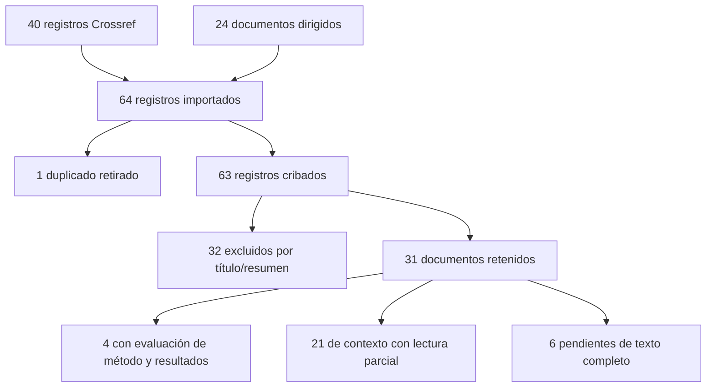

### Revisión de alcance con trazabilidad PRISMA: resultado parcial

#### Estado metodológico
Se ejecutó una búsqueda real y se conservaron exportaciones, decisiones y bibliografía. El resultado es un mapeo de alcance parcial, NO una revisión sistemática exhaustiva terminada. El requisito de una revisión profunda multibase no queda plenamente satisfecho: faltan cribado integral de resultados web, evaluación de muchos textos completos y acceso nativo a varias bases.

La elección de scoping review se fijó antes de buscar en revision/PROTOCOLO_PREVIO.md: las RQ mezclan recuperación, estructuras textiles, fundamentos matemáticos, anotación y gobernanza, con métricas no combinables. Se emplea PRISMA-ScR para el alcance, PRISMA2020 para hacer visible el flujo y PRISMA-S para registrar búsquedas, complementado con Kitchenham y Charters. Estos estándares son guías de reporte, no sellos de calidad ni prueba de exhaustividad.

Fecha de corte:20 de octubre de 2026, America/Lima. Un solo revisor, asistente computacional; no hubo doble cribado ni consenso humano. No hay registro prospectivo externo. El protocolo local precede a las búsquedas, pero las consultas se ampliaron adaptativamente. No se realizó metaanálisis.

#### Fuentes y acceso realmente utilizado

| Fuente | Uso observado | Limitación |
|---|---|---|
| Crossref | API nativa, cuatro consultas,10 registros por consulta,40 exportados | Top10 por relevancia, sin paginar todo el universo, no búsqueda exhaustiva |
| arXiv | Búsqueda web y acceso directo a resúmenes/HTML | No exportación temática exhaustiva nativa |
| SpringerLink | Artículo de hipergrafos completo, fichas de Rei y Duan | Parte del contenido editorial por suscripción |
| ACM DL | Localización de Brownlow y metadatos | Texto completo bloqueado en ACM y en el intento de copia institucional Birkbeck |
| IEEE Xplore | Registros localizados mediante web/Crossref | Sin búsqueda nativa ni texto completo validado |
| ScienceDirect | Registros DOI localizados | Intentos DOI sin texto evaluable |
| Scopus / Web of Science | No consulta nativa | No se dispone de exportación, NOT_RUN |
| Semantic Scholar / OpenAlex / Google Scholar | No consulta nativa ejecutada | No declarar cobertura por aparecer enlaces en arXiv |
| PMLR / JMLR / ACL / sitios oficiales | Resúmenes, fichas y enlaces primarios | Un enlace a PDF no equivale a lectura completa |

No se adquirieron artículos ni se ingresó a cuentas institucionales.

#### Estrategia reproducible
Exportaciones Crossref en crossref_1.json a crossref_4.json, consulta y URL exactas en consultas_crossref.json. Endpoint /works, rows=10, filter=until-pub-date:2026-10-20. Consultas literales:
1. multimodal museum cultural heritage retrieval
2. textile weaving pattern structural hypergraph
3. Andean weaving ontology
4. cultural heritage interpretable image retrieval

Crossref usa relevancia textual, no se afirma que estas cadenas se interpreten como booleanos. Los metadatos de resultados de búsquedas web dirigidas están en busqueda_01.json a busqueda_11.json cuando fueron conservadas. En algunas consultas exploratorias iniciales se guardaron metadatos de la respuesta pero no un archivo separado con la solicitud literal: esa parte de PRISMA-S permanece parcial y no se reconstruye como si fuese un registro original.

Las siete consultas de cierre tienen solicitud completa y metadatos de resultados en cierre_1.json y cierre_2.json. Incluyen familias patrimonio+multimodal+retrieval, textiles+hipergrafos/simetría, conceptos+interpretabilidad, datos pequeños+CV, anotación+acuerdo, ontología andina y recuperación patrimonial2026. Sus resultados adicionales no se declaran íntegramente cribados. El buscador puede ignorar operadores o ranking; conservar la cadena no garantiza reproducir su orden meses después.

Cadenas para siguiente búsqueda nativa, aún NOT_RUN:
- Scopus: TITLE-ABS-KEY(("cultural heritage" OR museum* OR textile* OR "Andean weaving") AND (multimodal OR retrieval OR CLIP OR hypergraph* OR ontolog*)).
- Web of Science: TS=(("cultural heritage" OR museum* OR textile*) AND (multimodal OR retrieval OR "structural representation")).
- IEEE/ACM: aplicar familias por separado a título/resumen, evitar una sola consulta con todos los temas.
- arXiv: combinar campos ti/abs y categorías cs.CV, cs.IR, cs.AI; registrar fecha y versiones.
No atribuir resultados o conteos a estas cadenas no ejecutadas.

#### Cribado y diagrama con conteos reales
El universo contabilizado contiene40 registros de Crossref y24 documentos seleccionados de búsquedas dirigidas/referencias para inspección. No incluye todos los enlaces devueltos por el buscador. Se deduplicó por DOI/título normalizado: un preprint de restauración aparece con el mismo título en dos plataformas. Se preservan como informes distintos la versión editorial de Rei y la ampliada2024, unidas como familia y sin sumarlas como dos experimentos independientes.

64 importados -1 duplicado =63 cribados.
63 -32 excluidos por título/resumen =31 retenidos para inspección.
31 =4 con evaluación de secciones de método/datos/resultados en texto completo +21 contextos con lectura parcial +6 pendientes de texto completo.
Los cuatro documentos evaluados son MUZE, Rei ampliado, Ngo2021 y Prasomphan2023. No se afirma lectura exhaustiva de todos sus anexos.

El diagrama es una adaptación transparente al mapeo parcial, no un diagrama que finja31 estudios incluidos por texto completo. Las razones individuales están en cribado_registros.csv. Los 32 excluidos tratan, por ejemplo, secciones editoriales de libros, museología sin método computacional transferible o restauración generativa fuera del núcleo definido. “Sin acceso” se registra como pendiente, no como evidencia negativa.

#### Extracción y calidad
La matriz principal contiene25 documentos de referencia,24 de búsqueda dirigida y uno de Crossref, con método, datos, métricas, hallazgo leído, limitaciones, código y decisión para tesis. Los40 registros y sus decisiones están en el anexo de cribado, de modo que la matriz no oculta descartes.

Cinco criterios binarios: M método explícito, E evaluación pertinente, C comparador, R recursos para reproducibilidad, L límites discutidos. Solo se puntúan los cuatro textos con evaluación sustantiva. MUZE 1/1/1/1/1, Rei ampliado1/1/1/0/1, Ngo1/1/1/1/1 y Prasomphan1/1/1/0/0. No sumar estos valores como ranking de superioridad ni equiparar recursos enlazados con reproducción ejecutada. El resto figura NA, no cero por baja calidad. Ninguno de los códigos de esos artículos se ejecutó aquí.

#### Síntesis por preguntas

| RQ | Síntesis sustentada y límites | Decisión |
|---|---|---|
| RQ1 representaciones patrimoniales | CLIP general, MUZE tabular, fusión imagen/texto/tabular de Rei y sistema KG de Duan muestran familias distintas | Baseline congelado y fusión tardía; no trasladar métricas entre tareas |
| RQ2 estructura textil | Ngo representa cruces de hilos; Brownlow aporta ontología andina; macrocomposición visible es otra escala | Definir escala de bandas/regiones y evitar prometer decodificación de tejido |
| RQ3 neuronal+simbólico | MUZE combina embedding y atributos; KG agrega restricciones; CBM ofrece intervención conceptual | Empezar por scores explicables; arquitectura compleja solo tras baseline |
| RQ4 mejora y explicación | Hay evidencia en dominios relacionados; no se verificó beneficio del descriptor propuesto en este corpus | Juicios independientes y ablación de relaciones, sin garantizar ganancia |
| RQ5 corpus pequeño y heterogéneo | Selección y CV pueden sobreajustar; muestra pequeña exige incertidumbre | Grupos, ajuste interno, LOMO y test nuevo |
| RQ6 expertos e incertidumbre | Acuerdo, procedencia y gobernanza son dimensiones diferentes | Medir acuerdo antes de adjudicar, preservar desconocido y no observable |
| RQ7 brecha andina | Existen antecedentes computacionales andinos; no se encontró evidencia suficiente de benchmark idéntico al propuesto | Contribución candidata en evaluación de macroestructura multimodal; prioridad no demostrada |

No se identificó un ensayo que permita afirmar hoy que grafos o descriptores combinatorios superarán CLIP en estas fotografías. Esa ausencia en la muestra recuperada no prueba inexistencia de trabajos en todo el campo.

#### Comparación de familias para decidir el alcance

| Familia | Evidencia cercana | Necesidad de datos | Horizonte |
|---|---|---|---|
| BM25 y visión simple | Controles de baja complejidad | Texto real e imágenes verificadas | H1 obligatoria |
| CLIP/OpenCLIP congelado | Representación general y precedente museal | Sin fine-tuning local | H1 obligatoria |
| Descriptor de bandas/relaciones | Motivación estructural, escala propia | Anotación visible y qrels independientes | H1 contribución central |
| Fusión tardía | Compatible con antecedentes multimodales | Desarrollo separado de test | H1 obligatoria |
| SigLIP2 / DINO | Alternativas recientes generales | Más inferencia, no nuevas etiquetas necesariamente | H2 opcional |
| WL / grafo jerárquico | Fundamento conocido | Regiones y relaciones consistentes | H2 si piloto justifica |
| MUZE entrenado / GNN / LLM re-ranking | Mayor complejidad y otras escalas | Datos, cómputo y validación adicionales | H3 |

#### Checklist PRISMA-ScR / PRISMA-S / Kitchenham
| Elemento | Ubicación/evidencia | Estado |
|---|---|---|
| Título y alcance | Este informe, “parcial” explícito | VERIFICADO |
| Justificación y RQ | Protocolo previo y tabla RQ | VERIFICADO |
| Protocolo/registro | Archivo local, sin registro público | PARCIAL |
| Elegibilidad | Protocolo, idiomas inglés/español, corte temporal | VERIFICADO |
| Fuentes y fecha | Tabla de acceso y JSON de consultas | VERIFICADO para lo declarado |
| Estrategias literales completas | Crossref y cierre completas; exploración inicial incompleta | PARCIAL |
| Límites y búsqueda adicional | Top10, búsqueda dirigida y cierre documentados | VERIFICADO |
| Selección y número de revisores | Un revisor; selección web no exhaustiva | PARCIAL |
| Extracción y variables | CSV principal y script de generación | VERIFICADO |
| Evaluación crítica | Cuatro textos; no todos los candidatos | PARCIAL |
| Conteos y exclusiones | CSV de 64 registros, JSON y diagrama | VERIFICADO para ese universo |
| Síntesis | RQ, familias y decisiones | PARCIAL por cobertura |
| Riesgo de sesgo entre estudios | Acceso, idioma, ranking y un revisor discutidos | PARCIAL |
| Precisión de efectos/metaanálisis | No comparable, no realizado | NOT_APPLICABLE |
| Limitaciones y conclusiones | Este informe | VERIFICADO |
| Financiación/conflictos | No consta financiación específica de auditoría; no se atribuyen conflictos no declarados | NO_VERIFICABLE |
| Exportación bibliográfica | referencias.bib, campos ausentes no inventados | VERIFICADO |

Para una entrega publicable: ampliar búsqueda nativa/paginada, cribar todo el universo importado, completar los seis pendientes y lectura sustantiva de antecedentes cruciales, incorporar segundo revisor donde sea posible, revisar autores/metadatos completos y actualizar conteos. Es trabajo bibliográfico pendiente, no motivo para paralizar correcciones del corpus ni el piloto.

#### Recuperación adicional y lección sobre métricas
El seguimiento de DOI recuperó el HTML completo de [Prasomphan (2023)](https://www.techscience.com/csse/v44n2/48253/html), registro C4-02, previamente pendiente. El artículo compara ADLFIG con ASEN y DGPCR sobre arquitectura tailandesa. Su Recall@K vale1 cuando existe al menos un positivo entre los primerosK, que corresponde a una tasa de acierto por consulta. Esta definición no coincide con la fracción de todos los relevantes recuperados. La tesis debe especificar denominadores y no importar cifras por compartir nombre de métrica. El registro de acceso y decisión se actualizó sin añadir un estudio duplicado. El intento de copia institucional de Brownlow no entregó texto evaluable.
