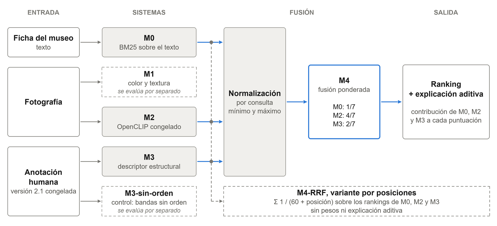

# 7. Diseño experimental

## 7.1 Principios del diseño

El plan experimental del primer avance, con una relevancia derivada de coincidencias de metadatos, dejaba abiertas tres cuestiones: quién decide qué resultado es pertinente, cómo se evita que el ajuste use los datos con que se evalúa y qué resultado sostendría o refutaría cada hipótesis. El diseño las resuelve con cinco principios.

1. **Protocolo previo.** Qué se compara, cómo se mide y qué cuenta como evidencia se fijó por escrito antes de observar cualquier resultado de prueba.
2. **Separación entre desarrollo y prueba.** Todo parámetro se fija en desarrollo, y la evaluación final se ejecuta una sola vez, con los sistemas congelados.
3. **Relevancia juzgada por una persona y a ciegas.** La pertinencia la decide un evaluador que ve solo las imágenes, sin saber qué sistema propuso cada candidato, y no se deriva de metadatos, de la anotación ni de un modelo. Responde al riesgo de circularidad entre anotación, sistema y juicio, la amenaza más seria del estudio (sección 7.13).
4. **Comparaciones de alcance explícito.** H1 compara el sistema combinado con el codificador visual que contiene y no aísla la estructura, porque la fusión también añade el texto de la ficha; el aporte de la estructura se examina en las ablaciones, exploratorias, y el del orden, frente a un control que conserva todo lo demás (H2).
5. **Resultados negativos válidos.** El diseño permite afirmar que la estructura no aporta con la misma solidez que lo contrario.

## 7.2 Galería, unidades y particiones

**Galería.** Las 150 piezas del núcleo de anotación, las únicas con anotación estructural (capítulo 4, sección 4.8). El resto del corpus principal queda fuera del experimento.

**Unidad de partición.** Varios registros pueden mostrar un mismo objeto o partes de él, y recuperar uno a partir de otro no prueba nada sobre la representación. Por eso la galería se parte por grupos de piezas relacionadas (capítulo 4, sección 4.6; capítulo 5, definición 5.2). Las 150 piezas forman 146 grupos, repartidos con semilla fija y estratificación por museo en desarrollo (30 %, 44 grupos) y prueba (70 %, 102 grupos). Una comprobación automática verifica, en cada ejecución del flujo, que ningún grupo esté en las dos particiones y que ninguna consulta figure entre sus propios candidatos.

**Unidad de análisis y galería transductiva.** Las métricas se calculan por consulta, y la inferencia remuestrea consultas. La galería es fija y contiene piezas de las dos particiones: los sistemas ven las piezas de prueba, pero no sus relevancias, y los juicios de prueba nunca se usan para ajustar nada. Se trata, por tanto, de una recuperación transductiva.

**Imagen.** Todos los sistemas usan la copia de evaluación de cada pieza (1600 píxeles de lado mayor), la misma sobre la que se hizo la anotación, verificada contra su suma SHA-256.

## 7.3 Tareas

**Cuadro 7.1.** Tareas del experimento.

| Tarea | Consulta | Candidatos | Relevancia | Sistemas | Papel |
|---|---|---|---|---|---|
| T3: estructura por ejemplar | Una pieza de la galería: su imagen y, para M0, el texto de su ficha | Las demás piezas, excluido el grupo de la consulta | Similitud de la organización visible (sección 7.6) | Todos, más ablaciones y control negativo | Primaria: H1, H2 y H3 |
| T1: texto a imagen | Una descripción en español redactada por el evaluador, sin copiar fichas, con una especificación estructural opcional | Toda la galería | Cumplimiento visible de la descripción | M0, M2 y M4; M3 solo si hay especificación | Secundaria y exploratoria |

En T3, M0 recibe el texto de la ficha de la pieza consultada en lugar de su imagen, una condición distinta que se identifica como tal. M1 no procesa texto y no participa en T1. Ningún cuadro se completa con valores para modalidades que un sistema no tiene.

T1 y T3 conservan la numeración del plan de tareas que precedió al protocolo; las demás tareas de ese plan quedaron fuera del estudio (capítulo 2, sección 2.2, y anexo C).

## 7.4 Sistemas

Se comparan cinco sistemas (M0 a M4), un control (M3-sin-orden) y una variante (M4-RRF), que la Figura 7.1 relaciona. Todos son deterministas y ninguno se entrena; los empates se resuelven por el identificador global de la pieza, en orden ascendente.

**Cuadro 7.2.** Sistemas comparados.

| Sistema | Entrada y puntuación | Parámetros y su origen |
|---|---|---|
| M0 | BM25 sobre el texto de la ficha: título original, título sugerido en español, descripción del museo, material y técnica. Se excluye la descripción de MET, una plantilla armada con los propios metadatos cuyas palabras fijas aproximarían entre sí las piezas de ese museo | $k_1 = 1{,}2$ y $b = 0{,}75$, valores habituales de Okapi BM25; términos de tres caracteres o más, sin lista de palabras vacías |
| M1 | Histograma de color en CIELAB (4 × 8 × 8 cubetas) y de patrones binarios locales de 8 vecinos invariantes a la rotación (10 valores) sobre el textil separado del fondo, a 320 píxeles de lado mayor; media de la mitad de la distancia L1 por bloque | Pesos iguales de color y textura |
| M2 | OpenCLIP congelado (`xlm-roberta-base-ViT-B-32`, pesos `laion5b_s13b_b90k`): vectores de imagen comparados por coseno. Cada imagen se lleva antes a un cuadrado rellenado con el color de sus márgenes, para que el recorte central no corte los extremos de las piezas alargadas | Punto de control y encuadre fijados el 5 de noviembre, antes de cualquier consulta |
| M3 | Descriptor estructural sobre la anotación congelada v2.1: composición, palabra de bandas (la secuencia de tipos de banda de la pieza) en forma canónica, adyacencias, borde decorado (la franja ornamental que enmarca la pieza, distinta del orillo), centro, simetría, repetición, motivos y familia iconográfica, con máscara de observabilidad. Disimilitud mixta $D(i, j)$ (capítulo 5, ecuación 5.18). Excluye el color, para que una eventual ganancia no sea de origen cromático | Pesos de bloque iguales a 1 |
| M3-sin-orden | Igual que M3, con la palabra de bandas sustituida por el histograma de sus tipos y sin adyacencias | Los mismos que M3 |
| M4 | Fusión tardía aditiva de M0, M2 y M3 con puntuaciones normalizadas por consulta; si M3 no tiene evidencia para un par, su peso se reparte entre los demás (capítulo 5, ecuación 5.21) | Pesos 1/7, 4/7 y 2/7, elegidos en desarrollo (sección 7.9) |
| M4-RRF | Fusión por posiciones recíprocas, $\sum_c 1/(60 + r_c)$, sobre los rankings de M0, M2 y M3 (Cormack et al., 2009); los pares sin evidencia estructural ocupan las últimas posiciones del ranking de M3 | Sin pesos; $k = 60$ fijo |

M3 y M4 son **sistemas asistidos por anotación**: disponen de etiquetas asignadas por una persona. La comparación con M2 mide la utilidad de disponer de ese conocimiento, no la capacidad de extraerlo de la imagen.

Los parámetros de M0, M1 y M3 se mantuvieron en sus valores de partida: con diez consultas de desarrollo, ajustar más grados de libertad habría aumentado el riesgo de sobreajuste. El único ajuste fue el de los pesos de M4.

## 7.5 Consultas

**Consultas de T3.** El 6 de noviembre, antes de ejecutar cualquier sistema, se sortearon con semilla fija 10 consultas de desarrollo y 30 de prueba entre los grupos de cada partición, a lo sumo una por grupo y solo entre piezas de composición observable. El sorteo se estratificó por museo y por tipo de composición, con cuotas por el método de los mayores restos, y no consultó ningún ranking.

**Regla de reemplazo.** Si, al corregir la anotación, una consulta deja de tener composición observable, la reemplaza la siguiente pieza elegible de su estrato en el orden de la semilla. Se aplicó una vez, antes de que existieran rankings o juicios de prueba: la consulta T3-P06 se había sorteado sobre una pieza cuya anotación describía, por un desplazamiento de filas, la imagen de otro registro, y con la anotación correcta su composición no es observable (capítulo 4, sección 4.10).

**Consultas de T1.** Seis consultas, solo de prueba, redactadas por el evaluador antes de ejecutar ningún sistema sobre ellas. Al no tener desarrollo propio, usan los pesos fijados en T3.

**Consultas con palabra de bandas.** De las 30 consultas de prueba, 9 corresponden a piezas con palabra de bandas; en desarrollo, 2 de 10. Este dato, que procede solo de la anotación, condiciona la potencia de H2 (sección 7.8).

## 7.6 Juicios de relevancia

### 7.6.1 Escala

Cada par formado por una consulta y un candidato se juzga en cuatro grados. En T3 se juzga cómo cada pieza reparte su superficie (por ejemplo, en franjas paralelas o bandas, en un campo central o en paneles), en qué orden aparecen sus partes y cómo se relacionan.

**Cuadro 7.3.** Escala de relevancia.

| Grado | T3: estructura por ejemplar | T1: texto a imagen |
|---|---|---|
| 3 | Las dos piezas organizan su superficie de la misma manera: el mismo tipo de composición, la misma secuencia de bandas o de regiones y las mismas relaciones entre ellas, aunque cambien los colores y los motivos | La pieza cumple toda la descripción |
| 2 | El mismo tipo de composición, pero las bandas o regiones aparecen en otro orden o se relacionan de otro modo | Cumple lo principal de la descripción |
| 1 | Las piezas comparten solo algún rasgo parcial de su organización | Cumple solo uno de los rasgos descritos |
| 0 | Las piezas se organizan de manera distinta | No cumple la descripción |

El estado `no_evaluable` se reserva para imágenes que no permiten juzgar. No equivale a 0: el par se excluye del ordenamiento ideal de la consulta y se informa su frecuencia. Todo juicio de grado 2 o 3 lleva una justificación breve con la evidencia visible.

### 7.6.2 Selección de los pares

Para cada consulta se juzgan los diez primeros resultados (en adelante, top 10) de M0, M1, M2, M3, M3-sin-orden, M4 y M4-RRF, sin repetir pares, más 10 candidatos elegidos al azar con semilla fija entre los que no proponen M0, M1 ni M2. La muestra al azar se define respecto del pool inicial para que no cambie al añadir otros sistemas: el pool solo crece. Las ablaciones y el control negativo se evalúan sobre el mismo conjunto de juicios.

Los candidatos no juzgados cuentan como 0, un supuesto de evaluación y no un juicio. Como los cuatro sistemas de H1 y H2 aportan su top 10 al pool, su nDCG@10 no depende de ese supuesto, salvo en que el ordenamiento ideal puede quedar incompleto si un relevante no entró al pool; el supuesto sí afecta a las ablaciones y al control negativo. Por eso se informan, por consulta, el pool, los relevantes y los `no_evaluable`, y por sistema, la proporción juzgada de su top 10 y su nDCG@10 recalculado tras tratar como no juzgados los pares que solo él aportó (Buckley et al., 2007). La unión de los primeros resultados de todos los sistemas protege a M3 y M4 del sesgo del pooling contra los sistemas ausentes del pool (Buckley et al., 2007, pp. 16–17), y la muestra al azar ofrece una referencia independiente de los sistemas, aunque su interacción con ese sesgo no está estudiada (p. 15).

En desarrollo, el pool reunió 419 pares. En prueba se juzgaron 1283 pares de T3, entre 29 y 51 por consulta, y 212 de T1.

### 7.6.3 Salvaguardas frente a la circularidad

El investigador definió el esquema de anotación, anotó las 150 piezas y es el evaluador. Su noción de similitud estructural se formó con las mismas categorías que usa M3, de modo que sus juicios pueden favorecer al descriptor sin que medie intención; un juez que comparte información con un sistema evaluado deja de ser un árbitro independiente (Soboroff, 2025). Las salvaguardas son de procedimiento:

1. Las consultas se fijaron antes de ejecutar cualquier sistema sobre ellas: las de T3 por sorteo y las de T1 por redacción.
2. Los juicios se hacen solo sobre las imágenes, sin consultar la anotación ni ver rankings, puntuaciones o el sistema que propuso cada candidato. Los candidatos se presentan en orden aleatorio, lo que evita favorecer a los documentos que muchos sistemas devuelven arriba (Sakai et al., 2022, pp. 16–17). Una comprobación automática verifica, antes de entregar el libro y al cerrarlo, que no contiene el sistema, la puntuación ni la posición, que conserva el orden sorteado y que su guía coincide con la rúbrica sellada al iniciar la corrida.
3. La escala y sus criterios se fijaron antes de juzgar. Ningún juicio se deriva de la anotación, del descriptor ni de OpenCLIP.
4. El evaluador no abre ningún informe con el rendimiento de los sistemas.

Estas medidas impiden que el evaluador sepa qué sistema propuso cada candidato, pero no que su criterio coincida con el del descriptor. La mitigación externa prevista era un doble juicio parcial: otra persona con criterio estructural juzgaría a ciegas los pools de 5 consultas de prueba elegidas al azar, con el acuerdo informado (kappa ponderado lineal) antes de cualquier adjudicación y la métrica primaria recalculada como sensibilidad. El protocolo lo condicionaba a disponer de un segundo evaluador; no lo hubo, y el doble juicio no se realizó, sin que ello sea una desviación del protocolo. Los resultados se informan con un evaluador único, cuyos juicios no se presentan como una verdad independiente de quien los emitió.

### 7.6.4 Juicios de desarrollo y su revisión asistida

Los juicios de desarrollo tuvieron dos etapas.

**Primera etapa.** El 12 de noviembre, el evaluador juzgó los 345 pares del pool inicial (M0, M1, M2 y la muestra al azar). Una comprobación posterior mostró que esos juicios apenas se relacionaban con la composición que el mismo investigador había anotado: recibió grado 2 o 3 el 14 % de los pares con la misma composición y el 11 % de los de composición distinta, y solo 5 de los 40 juicios de grado 2 o 3 llevaban la justificación exigida. La coincidencia de composición no es el patrón oro, y exigir que los juicios la reprodujeran reintroduciría la circularidad, pero el hallazgo indicaba que la rúbrica se había aplicado, al menos en parte, con un criterio de parecido global. Los juicios se conservaron y su uso se limitó a los pesos de M4 y a la planificación de la potencia.

**Segunda etapa.** El 19 de noviembre, los juicios de desarrollo, ya ampliados con los candidatos de M3 y M3-sin-orden, se revisaron con la segunda opinión ciega de un modelo de visión y lenguaje de uso general (Claude Opus 5.5, de Anthropic, en cinco instancias con las mismas instrucciones), que no es CLIP ni ninguno de los sistemas evaluados. El modelo vio solo las dos imágenes de cada par y la rúbrica, sin acceso a los grados del evaluador, los rankings, los sistemas ni la anotación; el evaluador revisó cada par con esa opinión a la vista y firmó el grado y la justificación finales. El acuerdo previo era bajo: kappa ponderado lineal de 0,161, el único independiente, porque se midió antes de que el evaluador viera la opinión. Tras la revisión, el evaluador había cambiado 246 de los 411 grados, el acuerdo subió a 0,925 y la justificación firmada coincidía con la del modelo en 406 de los 411 pares. Son, por tanto, juicios humanos asistidos por un modelo: la firma establece la responsabilidad humana del juicio, pero no lo convierte en una validación independiente.

**Riesgo de anclaje.** Esas cifras indican que el evaluador adoptó casi siempre la propuesta del modelo. Quien revisa la salida de una ayuda automática tiende a usarla como sustituto de la búsqueda atenta de información, incluso con experiencia en el dominio y con instrucciones de verificar (Parasuraman y Manzey, 2010, pp. 391 y 397). Esa revisión no trata modelos de visión y lenguaje; su extensión a ellos es una inferencia de este trabajo. La segunda opinión pudo corregir errores del evaluador o desplazar su criterio hacia el del modelo, y los datos no permiten distinguir entre ambas cosas.

**Archivo de auditoría.** El material de la revisión se conserva en un archivo de auditoría privado, cuya huella y descripción figuran en el anexo B; separa los 411 juicios con que se eligieron los pesos de M4 de los 8 que la fusión añadió después al pool, juzgados sin asistencia y no usados para reajustar nada.

**Alcance.** Los juicios de desarrollo intervienen en la elección de los pesos de M4 (sección 7.9) y en la estimación del efecto mínimo detectable (sección 7.8), no en ninguna hipótesis. El argumento de Soboroff (2025) contra los juicios hechos por modelos de lenguaje se apoya en que el conjunto de juicios actúa como techo: si el juez está entre los sistemas evaluados, los que lo superen parecerán peores. Ese mecanismo no opera aquí del mismo modo, porque el modelo revisor no es ninguno de los sistemas comparados y no propuso candidatos. Queda un riesgo más difuso: un modelo visión-lenguaje de propósito general puede compartir con M2 una noción de semejanza visual, y unos pesos elegidos con juicios influidos por él podrían favorecer al componente visual de la fusión o penalizar al estructural, en una dirección que no puede establecerse. Por eso los juicios de prueba se emitieron sin ninguna asistencia: las conclusiones confirmatorias no dependen de juicios de un modelo.

### 7.6.5 Juicios de prueba

Los juicios de prueba se emitieron sin asistencia de modelos: el evaluador juzgó solo y a ciegas, y su grado es el único que se usó. M3 y M4 usaron, no obstante, la anotación congelada, cuya revisión incluyó asistencia (capítulo 4, sección 4.10). La decisión responde a la pregunta de investigación, que pide juicios humanos independientes de los sistemas; Soboroff (2025) admite el uso de un modelo para detectar errores de los evaluadores, pero no como fuente de los juicios con que se decide una comparación.

**Estabilidad del evaluador.** Los juicios de prueba se emitieron una sola vez, sin rejuzgar una submuestra, de modo que no se estimó su estabilidad intraevaluador. La estabilidad que la tesis informa es la de la anotación (capítulo 4), que no la sustituye.

**Consultas sin relevantes.** Si ningún candidato de una consulta alcanza el grado 1, su nDCG no está definido: la consulta se excluye de la media, se informa y no se reemplaza.

## 7.7 Métricas e inferencia

**Métricas.** La primaria es nDCG@10 por consulta de T3, con ganancia $2^{\mathrm{rel}} - 1$ y descuento $\log_2(r + 1)$; el ordenamiento ideal se calcula con todos los juicios de la consulta. Las secundarias son la precisión en 10 y el rango recíproco medio, con la relevancia binarizada en el grado 2, y la proporción juzgada del top 10. En T1 se informan las mismas métricas de forma descriptiva.

**Estimandos.** Para H1, la media sobre las consultas de prueba evaluables de $\Delta_q = \mathrm{nDCG@10}(\mathrm{M4}) - \mathrm{nDCG@10}(\mathrm{M2})$; para la ablación M4 sin M3, la media de $\mathrm{nDCG@10}(\mathrm{M4}) - \mathrm{nDCG@10}(\mathrm{M4\ sin\ M3})$; para H2, la media de $\Delta_q = \mathrm{nDCG@10}(\mathrm{M3}) - \mathrm{nDCG@10}(\mathrm{M3\text{-}sin\text{-}orden})$, y para el subgrupo de bandas, esa media en las consultas con palabra de bandas. Una consulta es evaluable si tiene nDCG definido en los dos sistemas; $n$ es su número. Una diferencia con $\lvert \Delta_q \rvert \le 10^{-12}$ cuenta como cero, para que un redondeo no convierta en distinta de cero una diferencia nula por construcción.

**Contraste de H1.** H1 se formula como en el capítulo 2 (sección 2.5): la diferencia media por consulta de nDCG@10 entre M4 y M2 es distinta de cero en la prueba de permutación ($p < 0{,}05$) y la diferencia observada es igual o superior a 0,03. La prueba es una permutación pareada por cambio de signo, bilateral. Como enumerar los $2^{30}$ cambios de signo es impracticable, la $p$ se estima con un número fijo de réplicas, $B = 100\,000$, y semilla fija: $p = (b + 1)/(B + 1)$, donde $b$ es el número de réplicas al menos tan extremas como la observada. El cálculo termina solo al completar las $B$ réplicas, y se informa su error de Monte Carlo, $\sqrt{p(1 - p)/B}$. La t de Student pareada se informa como comprobación; si discrepan, decide la permutación. La elección se apoya en Smucker et al. (2007, pp. 631–632), que recomiendan la aleatorización siempre que sea aplicable, y en Urbano et al. (2019, pp. 6–7), según quienes, con 25 temas, la permutación y la t mantienen el error de tipo I cerca del nominal y el bootstrap usado como prueba resulta demasiado optimista. Ninguno de los dos estudios trata nDCG@10 ni valida este diseño, aunque 30 consultas quedan dentro de su rango.

**Contraste de H2.** Solo pueden ser distintas de cero las diferencias de las 9 consultas de prueba con palabra de bandas, de modo que la distribución de referencia se calcula exactamente: se enumeran los $2^m$ vectores de signos de las $m$ diferencias distintas de cero ($m \le 9$), y la $p$ bilateral es la proporción de vectores cuyo estadístico iguala o supera al observado. La $p$ mínima alcanzable es $2/2^m$: con $m \le 5$ vale al menos 0,0625 y H2 no puede alcanzar $p < 0{,}05$; con $m = 0$, $p = 1$. La exactitud del cálculo no corrige un sesgo de selección ni la incertidumbre de una muestra tan pequeña. Como las diferencias son cero fuera del subgrupo, el umbral práctico de 0,03 sobre las $n$ consultas equivale a $0{,}03 \cdot n/b$ en las $b$ consultas evaluables con bandas: 0,10 con 30 y 9.

**Intervalo.** El intervalo de confianza del 95 % de $\Delta$ se obtiene por bootstrap pareado de consultas, por percentiles, con 10 000 réplicas, semilla fija y el mismo remuestreo para los dos sistemas. Describe la magnitud y su incertidumbre, pero no decide las hipótesis.

**Regla de decisión.** La regla separa tres afirmaciones: la evidencia frente a una diferencia nula ($p < 0{,}05$), la estimación de $\Delta$ con su intervalo y la relevancia práctica de la diferencia observada ($\Delta \ge 0{,}03$). Una hipótesis comparativa se sostiene solo con la primera y la tercera. Las demás combinaciones se leen como «mejora distinta de cero, por debajo del umbral práctico» ($p < 0{,}05$ y $0 < \Delta < 0{,}03$), «inferior al sistema de referencia» ($p < 0{,}05$ y $\Delta < 0$), «dirección favorable sin evidencia suficiente» ($p \ge 0{,}05$ y $\Delta > 0$) y «no se detectó una mejora» ($p \ge 0{,}05$ y $\Delta \le 0$). El umbral de 0,03, una mejora pequeña pero apreciable en la posición de los relevantes dentro del top 10, se aplica a la diferencia observada: que H1 se sostenga no significa que el efecto poblacional alcance 0,03, umbral que no se contrasta. Con potencia limitada, además, un efecto seleccionado por significación puede estar sobrestimado (Card et al., 2020).

**Comparaciones múltiples.** H1 y H2 son confirmatorias y se contrastan en una secuencia fija: H1 primero, con $\alpha = 0{,}05$, y H2 solo recibe una conclusión confirmatoria si H1 cumple su regla completa; si no, se informa como exploratoria. Esa secuencia controla la tasa de error por familia, y la exigencia de $\Delta \ge 0{,}03$ la hace más conservadora; se prefirió al procedimiento de Holm porque H1 es la hipótesis primaria. Como H1 se sostuvo (capítulo 8), H2 se contrastó de forma confirmatoria. El subgrupo de bandas es descriptivo, y las comparaciones frente a M0, M1 y M3, las ablaciones, el control negativo y los análisis por museo son exploratorios: se informan con su intervalo, sin interpretar su $p$ como confirmación.

## 7.8 Potencia y efecto mínimo detectable

La potencia se planificó antes del experimento, no a posteriori con el efecto observado, una práctica que Card et al. (2020, p. 2, nota 2) desaconsejan. Con la desviación estándar de las diferencias pareadas en las diez consultas de desarrollo, el efecto mínimo detectable con 30 consultas, potencia del 80 % y $\alpha = 0{,}05$ bilateral es

$$\text{EMD} = \frac{(z_{0{,}975} + z_{0{,}8})\, \widehat{\sigma}_\Delta}{\sqrt{30}} \approx 0{,}51\, \widehat{\sigma}_\Delta, \tag{7.1}$$

y el número de consultas necesario para detectar el umbral práctico es $n \approx [(z_{0{,}975} + z_{0{,}8})\, \widehat{\sigma}_\Delta / 0{,}03]^2$. El rango del efecto procede del intervalo del 95 % de la desviación estimada con diez observaciones, bajo normalidad. El cálculo se hizo el 21 de noviembre, con los 419 juicios de desarrollo y los pesos de M4 ya fijados, sin informar el nDCG medio de ningún sistema ni el signo de las diferencias.

**Cuadro 7.4.** Planificación de la potencia antes de la evaluación final.

| Comparación | Base del cálculo | Resultado |
|---|---|---|
| H1: M4 frente a M2 | Desviación de las diferencias en 10 consultas de desarrollo: 0,169 | EMD con 30 consultas: 0,087 (rango de 0,060 a 0,159); unas 250 consultas para 0,03 |
| H2: M3 frente a M3-sin-orden | Prueba exacta con $m \le b = 9$ diferencias distintas de cero | $p$ mínima: 0,0039 si $m = 9$; $p < 0{,}05$ exige al menos 6 diferencias distintas de cero |
| H2, subgrupo de bandas | 2 consultas de desarrollo y 9 de prueba | Umbral equivalente: 0,10; descriptivo |

- **H1.** El valor de 0,087 es una estimación de planificación basada en diez consultas, no una frontera. Indicaba que el estudio no tenía potencia para el umbral de 0,03; por eso un resultado no significativo se informa como «no se detectó una mejora», no como ausencia de efecto.
- **H2.** El margen del orden es estrecho por construcción del corpus, y el subgrupo de bandas, con solo dos consultas de desarrollo, no tiene base para estimar su variabilidad. En 21 de las 30 consultas de prueba la pieza no tiene palabra de bandas y la diferencia entre M3 y su control es cero; en toda la galería, de los 1378 pares entre piezas con palabra de bandas, solo 25 comparten la proporción de tipos y difieren en su secuencia (capítulo 5, sección 5.13). Con tan pocas diferencias distintas de cero, la distribución de la prueba es discreta y una aproximación normal del efecto mínimo detectable no vale, de modo que se informa la $p$ mínima alcanzable.

El número de consultas de prueba se mantuvo en 30 porque es lo que el calendario de juicios permitía: alcanzar la potencia deseada para H1 habría exigido unas 250 consultas y, con unos 43 pares por consulta, del orden de 10 700 pares por juzgar. Las estimaciones tienen dos debilidades: proceden de diez consultas, y estimar la varianza con datos de validación puede inducir exceso de confianza (Card et al., 2020, p. 16); y dependen de juicios de desarrollo asistidos (sección 7.6.4).

## 7.9 Selección de los pesos de M4

Los pesos de M4 se eligen en la rejilla $\{0;\ 0{,}25;\ 0{,}5;\ 0{,}75;\ 1\}$ para cada componente, normalizados a suma 1, lo que da 91 combinaciones distintas. La regla toma la de mayor nDCG@10 medio en desarrollo; en caso de empate, la más cercana a pesos iguales, y después la primera en orden lexicográfico descendente.

La selección se hizo **una sola vez**, el 21 de noviembre, con los 411 juicios de desarrollo vigentes, y eligió M0 = 1/7, M2 = 4/7 y M3 = 2/7. No se repitió porque los candidatos de M4 dependen de los pesos: el top 10 de la fusión elegida incluía pares sin juzgar, y volver a elegir tras juzgarlos convertiría la selección en un ciclo. Los ocho pares añadidos se juzgaron después y se usaron solo para la potencia. Un paso del flujo comprueba, sin modificarlos, que con los 419 juicios la regla sigue eligiendo los mismos pesos.

Bruch et al. (2023) muestran que la combinación convexa necesita pocas consultas etiquetadas para ajustar su peso, pero su análisis cubre dos sistemas y no respalda un número absoluto como diez consultas (capítulo 3, sección 3.7). La variante M4-RRF, sin pesos, permite estimar cuánto del resultado de M4 depende de ese ajuste.

## 7.10 Ablaciones y control negativo

Las ablaciones se calculan sobre las mismas consultas y candidatos que la comparación principal, y son exploratorias: M4 sin M3 (solo texto e imagen); M4 sin M0; M4 con M3-sin-orden en lugar de M3; M3 solo con los bloques de bandas (palabra y adyacencias) frente a M3 con todos los demás bloques, de modo que los dos lados cubren el descriptor sin solaparse, y M4-RRF. Retirar un componente de M4 equivale a declararlo sin evidencia para todos los candidatos, con renormalización de los pesos restantes (capítulo 5, proposición 5.9), de modo que las ablaciones usan la misma fórmula que el sistema completo.

**Control negativo.** M4 se recalcula con los descriptores de M3 permutados al azar entre piezas del mismo museo, con una sola permutación de semilla fija: si el aporte de la estructura es real, debe desaparecer. Es descriptivo, porque una sola permutación no ofrece una distribución nula, y al conservar la distribución de descriptores de cada museo comprueba además que una eventual ganancia no procede de que la anotación capture, indirectamente, el museo de procedencia.

**Robustez.** Los resultados se describen según el museo de la consulta y según la completitud que el revisor registró al curar la pieza consultada: completo, incompleto o sin dato. El tercer grupo se mantiene porque 61 de las 150 piezas no mencionan la completitud, y asignarlas a otro introduciría un error de clasificación.

**Tarea T1.** M0 compara la descripción con el texto de las fichas; M2, el vector de texto de la descripción (sin plantilla, porque T1 no tiene desarrollo) con los vectores de imagen; M3 actúa solo sobre los bloques de la especificación estructural, cuando la hay, y M4 fusiona los componentes disponibles con los pesos de T3. Los resultados son descriptivos.

## 7.11 Fidelidad computacional (H3) y revisión de las explicaciones

Para cada resultado del top 10 de M4 en prueba se registran las contribuciones $\alpha'_c\, \hat{s}_c$ de cada componente, la máscara de observabilidad y la procedencia de cada valor. H3, la fidelidad computacional de la descomposición de M4, se sostiene si se cumplen dos comprobaciones en todos los resultados, con un error máximo de $10^{-9}$:

1. **Reconstrucción.** La suma de las contribuciones coincide con la puntuación.
2. **Intervención.** Retirar un componente modifica la puntuación exactamente como predice la fórmula, incluida la regla de reparto de pesos.

Ambas son identidades de la fórmula (capítulo 5, proposición 5.9): lo que se contrasta es que la implementación las satisface. Demuestran fidelidad a la implementación y a su fórmula aditiva, no la inteligibilidad de la explicación ni su utilidad para especialistas, la distinción que Jacovi y Goldberg (2020) trazan entre fidelidad y plausibilidad. M4-RRF no interviene en H3, porque al operar sobre posiciones no conserva la descomposición de la puntuación.

**Revisión humana de las explicaciones.** Es descriptiva y no interviene en el veredicto de H3. Un *acierto* es un resultado del top 10 de M4 juzgado con grado 2 o 3, y un *error*, uno con grado 0 o 1. Se sortean con semilla fija 5 aciertos y 5 errores; si una clase tiene menos, se usan todos sin completar la cuota. Cada ficha muestra las dos imágenes, las contribuciones y su procedencia, sin la clase, el grado ni la posición, en orden aleatorio, y el evaluador la valora como correcta, incorrecta, especulativa o no evaluable, con un código que indica el componente en desacuerdo y una justificación; las no evaluables no se reemplazan. Como el revisor es el evaluador, que anotó la estructura que usa M3, la revisión se informa como descripción de casos, sin tasas ni contraste.

## 7.12 Orden de ejecución y criterios de suspensión

El experimento siguió un orden obligatorio: congelación de los grupos, las particiones y la anotación (anotación v2.1, 17 de noviembre de 2026); desarrollo, con rankings, juicios, selección de los pesos de M4 y estimación de la potencia (completado el 21 de noviembre); autorización del protocolo (23 de noviembre de 2026) y congelación de los sistemas, y una única ejecución de la evaluación final, entre el 23 y el 24 de noviembre, por estados sellados.

La corrida pasó por cinco estados registrados en un manifiesto de ejecución (autorizada, insumos sellados, rankings sellados, juicios cerrados y evaluada), y ningún paso podía ejecutarse sin que el anterior estuviera registrado: las sumas SHA-256 de los insumos se sellaron antes de calcular ningún ranking, y la evaluación recalculó todas las sumas antes de calcular ninguna métrica. Cada estado queda acreditado por una etiqueta de versión anotada y un registro de custodia con la fecha, el responsable y las sumas (anexo B).

**La evaluación final no se abría** si había grupos repartidos entre particiones, juicios de prueba derivados de un modelo, cambios sin registro en la guía de anotación o en el protocolo, pesos ajustados con datos de prueba, imágenes sin verificar o sumas del manifiesto que no coincidieran. Una comprobación automática reunió las condiciones verificables en el repositorio, y la orden de los rankings de prueba se negaba si encontraba un problema. No se dio ninguna de esas condiciones, y la corrida no tuvo fallos, suspensiones ni desviaciones del protocolo.

## 7.13 Amenazas a la validez

El Cuadro 7.5 ordena las amenazas según el tipo de validez que comprometen e indica cómo las mitigó el diseño. El capítulo 11 examina cuáles subsisten a la vista de los resultados.

**Cuadro 7.5.** Amenazas a la validez y su mitigación.

| Amenaza | Validez | Mitigación |
|---|---|---|
| A1. Una misma persona anota la estructura que usa M3 y juzga la relevancia; es la amenaza principal | Interna y de constructo | Juicio ciego y aleatorizado; consultas fijadas de antemano. El doble juicio parcial previsto no se realizó por falta de segundo evaluador |
| A2. Los juicios de desarrollo se aplicaron con un criterio de parecido global y se revisaron con asistencia | De constructo | Uso limitado a los pesos de M4 y a la potencia; prueba sin asistencia; archivo de auditoría con huella (sección 7.6.4) |
| A3. Un solo anotador | De constructo | Re-anotación ciega de 30 piezas y estabilidad por atributo, que mide estabilidad y no acuerdo entre personas |
| A4. Frontera inestable entre lo observable y lo no observable | De constructo | Cobertura de bloques informada en cada comparación |
| A5. Anotación con lecturas distintas y revisión asistida | Interna | Criterios escritos y revisión de los lotes 2 a 5 antes de congelar; análisis de sensibilidad (capítulo 4, sección 4.10.1) |
| A6. El eje y el sentido de lectura dependen de la fotografía | De constructo | Equivalencia por reversión; el eje no entra en el descriptor |
| A7. La estructura no es independiente de la técnica ni de la tradición | De constructo | Control sin orden; control negativo dentro de cada museo |
| A8. Solo se juzgan los primeros candidatos de cada sistema | Interna | Pool con todos los sistemas y una muestra al azar; proporción juzgada y sensibilidad al pool |
| A9. Piezas relacionadas en particiones distintas | Interna | Grupos decididos antes de partir; comprobación automática |
| A10. Las fotografías pudieron formar parte del preentrenamiento de M2 | Interna | No puede medirse; favorecería a M2 |
| A11. Pocas consultas de prueba | De conclusión estadística | Permutación pareada, intervalo, potencia planificada y $p$ exacta en H2 |
| A12. Estabilidad del evaluador en prueba | De conclusión estadística | Juicio ciego con escala fijada de antemano; no se estimó, porque no hubo rejuicio |
| A13. Pesos de M4 elegidos con diez consultas | De conclusión estadística | Rejilla pequeña, selección única y variante sin pesos |
| A14. M3 dispone de información humana que M2 no tiene | De constructo y externa | Comparación presentada como asistida por anotación; M3 excluye el color |
| A15. El corpus no es una muestra de los textiles andinos | Externa | Población definida de forma restrictiva; resultados por museo |
| A16. Diferencias fotográficas entre museos | Interna y externa | Copia de evaluación común; M1 sobre el textil segmentado; descripción por museo |

Tres amenazas requieren un comentario. **A7:** la organización visible depende en parte de la técnica con que se tejió la pieza (capítulo 3, sección 3.2), de modo que una similitud estructural alta puede reflejar la pertenencia a una misma tradición técnica, que un codificador visual también capta por la textura y el color; el control sin orden aísla la secuencia respecto de la composición por tipos y el control negativo descarta el museo, pero ninguno separa por completo estructura y tradición. **A10:** las fotografías de MET, CMA y AIC son públicas y pudieron formar parte de los datos con que se entrenó el codificador de M2, como reconocen Baldrati et al. (2022) para colecciones de arte; esa posible fuga favorecería a M2 y hace más conservadora la comparación de H1. **A14:** el tiempo de anotación por pieza no se registró y el costo de anotar no se mide, de modo que la tesis no compara la ganancia con el esfuerzo que la produce.

H3 queda fuera del alcance de estas amenazas, porque es una propiedad del algoritmo y de su implementación; a cambio, no dice nada sobre el significado de las contribuciones ni equivale a una validación por especialistas.

## Referencias

Baldrati, A., Bertini, M., Uricchio, T., et al. (2022). Exploiting CLIP-based multi-modal approach for artwork classification and retrieval. Springer. https://doi.org/10.1007/978-3-031-20302-2_11

Bruch, S., Gai, S., & Ingber, A. (2023). *An analysis of fusion functions for hybrid retrieval* (arXiv:2210.11934v2). arXiv. https://arxiv.org/abs/2210.11934

Buckley, C., Dimmick, D., Soboroff, I., & Voorhees, E. (2007). Bias and the limits of pooling for large collections. *Information Retrieval, 10*, 491–508. https://doi.org/10.1007/s10791-007-9032-x

Card, D., Henderson, P., Khandelwal, U., Jia, R., Mahowald, K., & Jurafsky, D. (2020). *With little power comes great responsibility* (arXiv:2010.06595). arXiv. https://arxiv.org/abs/2010.06595

Cormack, G. V., Clarke, C. L. A., & Büttcher, S. (2009). Reciprocal rank fusion outperforms Condorcet and individual rank learning methods. En *Proceedings of the 32nd International ACM SIGIR Conference on Research and Development in Information Retrieval*. ACM.

Jacovi, A., & Goldberg, Y. (2020). *Towards faithfully interpretable NLP systems: How should we define and evaluate faithfulness?* (arXiv:2004.03685). arXiv. https://arxiv.org/abs/2004.03685

Parasuraman, R., & Manzey, D. H. (2010). Complacency and bias in human use of automation: An attentional integration. *Human Factors, 52*(3), 381–410. https://doi.org/10.1177/0018720810376055

Sakai, T., Tao, S., & Zeng, Z. (2022). *Relevance assessments for web search evaluation: Should we randomise or prioritise the pooled documents? (Corrected version)* (arXiv:2211.00981). arXiv. https://arxiv.org/abs/2211.00981

Smucker, M. D., Allan, J., & Carterette, B. (2007). A comparison of statistical significance tests for information retrieval evaluation. En *Proceedings of the 16th ACM Conference on Information and Knowledge Management (CIKM '07)* (pp. 623–632). ACM. https://doi.org/10.1145/1321440.1321528

Soboroff, I. (2025). Don't use LLMs to make relevance judgments. *Information Retrieval Research, 1*(1), 29–46. https://doi.org/10.54195/irrj.19625

Urbano, J., Lima, H., & Hanjalic, A. (2019). Statistical significance testing in information retrieval: An empirical analysis of type I, type II and type III errors. En *Proceedings of the 42nd International ACM SIGIR Conference on Research and Development in Information Retrieval (SIGIR '19)*. ACM. https://doi.org/10.1145/3331184.3331259
