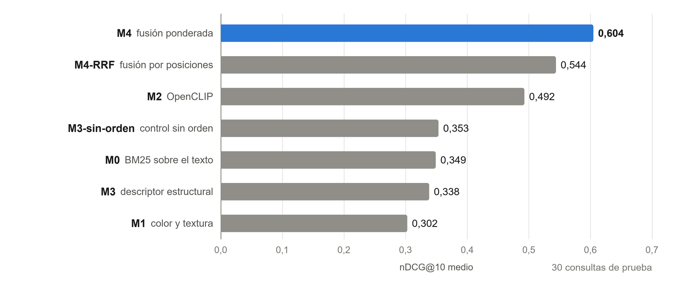
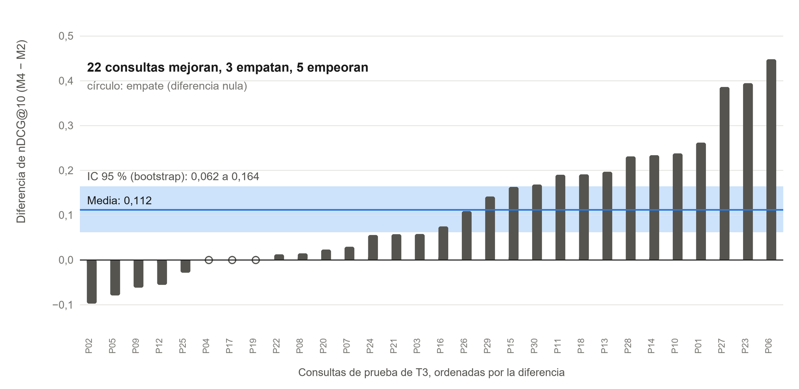

# 8. Resultados

Este capítulo informa los resultados de la ejecución única del experimento descrito en el capítulo 7, en el orden en que allí se fijaron: primero la tarea primaria T3 y sus hipótesis, después los análisis exploratorios y, al final, la tarea T1. Las cifras proceden del informe generado por la evaluación y de las métricas por consulta, ambos sellados con su suma SHA-256; ninguna se recalculó para este texto. La interpretación se reserva para el capítulo 9.

## 8.1 Ejecución y juicios

La evaluación final se ejecutó una sola vez, entre el 23 y el 24 de noviembre de 2026, con los sistemas congelados y los pesos de M4 elegidos en desarrollo (1/7 para M0, 4/7 para M2 y 2/7 para M3). La evaluación volvió a calcular las 25 sumas de los insumos, los *rankings*, el *pool* y los juicios, y todas coincidieron con las registradas al sellar cada etapa. La comprobación automática del cegamiento no encontró en los libros de juicio el sistema de origen, la puntuación ni la posición de ningún candidato. No se registraron fallos ni suspensiones. Se produjo una desviación del procedimiento de custodia: las sumas de cada etapa se enviaron al asesor juntas al terminar la evaluación, y no al sellar cada etapa. La verificación de los archivos sellados no detectó discrepancias; el envío tardío limita la constancia externa contemporánea de la secuencia de ejecución (anexo B).

El evaluador juzgó sin asistencia 1283 pares de T3, correspondientes a las 30 consultas de prueba (entre 29 y 51 pares por consulta), y 212 pares de T1. El Cuadro 8.1 resume la distribución de los grados.

**Cuadro 8.1.** Distribución de los juicios de prueba.

| Tarea | Pares | Grado 0 | Grado 1 | Grado 2 | Grado 3 | No evaluable |
|---|---:|---:|---:|---:|---:|---:|
| T3 (estructura) | 1283 | 858 (66,9 %) | 145 (11,3 %) | 211 (16,4 %) | 69 (5,4 %) | 0 |
| T1 (texto) | 212 | 145 (68,4 %) | 15 (7,1 %) | 19 (9,0 %) | 33 (15,6 %) | 0 |

Ninguna imagen se marcó como no evaluable y todas las consultas de T3 tienen al menos un candidato relevante, de modo que el nDCG@10 está definido en las 30. La consulta con menos relevantes, T3-P19, tiene un solo candidato de grado 1 y ninguno de grado 2 o superior; en el otro extremo, T3-P18 reúne 17 candidatos de grado 2 o 3 en un *pool* de 35. Los siete *rankings* que aportaron sus diez primeros resultados al *pool* (los cinco sistemas, el control sin orden y la variante por posiciones) quedaron juzgados por completo: su proporción juzgada del top 10 es 1,000.

## 8.2 Rendimiento de los sistemas en T3

El Cuadro 8.2 reúne las tres métricas de todos los sistemas y variantes en las 30 consultas de prueba. La precisión en 10 (P@10) y el rango recíproco medio (MRR) usan la relevancia binarizada en el grado 2. La última columna indica qué parte de los diez primeros resultados de cada sistema fue juzgada; en las variantes que no aportaron candidatos al *pool*, los no juzgados cuentan como irrelevantes y sus métricas son, por tanto, cotas inferiores.

**Cuadro 8.2.** Métricas medias en T3 (30 consultas de prueba).

| Sistema o variante | nDCG@10 | P@10 | MRR | Proporción juzgada del top 10 |
|---|---:|---:|---:|---:|
| M0: texto de la ficha (BM25) | 0,349 | 0,283 | 0,586 | 1,000 |
| M1: color y textura | 0,302 | 0,237 | 0,532 | 1,000 |
| M2: OpenCLIP | 0,492 | 0,373 | 0,633 | 1,000 |
| M3: descriptor estructural | 0,338 | 0,293 | 0,517 | 1,000 |
| M3-sin-orden | 0,353 | 0,300 | 0,542 | 1,000 |
| **M4: fusión de M0, M2 y M3** | **0,604** | **0,487** | 0,664 | 1,000 |
| M4-RRF: fusión por posiciones | 0,544 | 0,433 | **0,719** | 1,000 |
| *Ablaciones y control* | | | | |
| M4 con M3-sin-orden | 0,608 | 0,490 | 0,672 | 0,993 |
| M4 sin M0 | 0,570 | 0,453 | 0,664 | 0,947 |
| M4 sin M3 | 0,523 | 0,387 | 0,702 | 0,970 |
| M3 sin bandas | 0,347 | 0,300 | 0,530 | 0,907 |
| M3 solo bandas | 0,105 | 0,093 | 0,189 | 0,397 |
| Control negativo (M3 permutado) | 0,418 | 0,307 | 0,636 | 0,833 |

Entre los sistemas individuales (Figura 8.1), M2 obtiene el mejor nDCG@10 (0,492), seguido a distancia por M0, M3-sin-orden y M3, con valores entre 0,338 y 0,353, y por M1 (0,302). M4 supera a todos los sistemas individuales en nDCG@10 y en P@10. En MRR, que solo mide la posición del primer relevante, el orden cambia: M4-RRF (0,719) y M4 sin M3 (0,702) colocan antes su primer acierto que M4 (0,664).

## 8.3 Hipótesis H1: M4 frente a M2

El Cuadro 8.3 resume el contraste de H1.

**Cuadro 8.3.** Contraste de H1.

| Elemento | Valor |
|---|---|
| Consultas evaluables (n) | 30 |
| nDCG@10 medio de M4 y de M2 | 0,604 y 0,492 |
| Diferencia media Δ | 0,112 |
| Intervalo de confianza del 95 % (*bootstrap* pareado) | 0,062 a 0,164 |
| p de la prueba de permutación (B = 100 000) | 0,00015 (error de Monte Carlo 0,00004) |
| t de Student pareada (comprobación) | t = 4,259; p = 0,0002 |
| Diferencia frente a cero (p < 0,05) | Sí |
| Relevancia práctica (Δ ≥ 0,03) | Sí |
| Veredicto | **H1 se sostiene** |

La diferencia es positiva en 22 de las 30 consultas, nula en 3 y negativa en 5 (Figura 8.2). Su mediana es 0,066; la mayor pérdida de M4 frente a M2 es de 0,097 y la mayor ganancia, de 0,448. La prueba de permutación y la t pareada coinciden, y el intervalo excluye el cero. La diferencia observada supera tanto el umbral práctico de 0,03 como el efecto mínimo detectable que se había estimado en la planificación (0,087, sección 7.8), aunque, como se advirtió allí, que H1 se sostenga no implica que el efecto poblacional alcance ese umbral, que no se contrastó.

H1 compara el sistema combinado con su componente visual. No aísla la aportación de la estructura, porque M4 añade también el texto de la ficha; esa cuestión se examina en las ablaciones (sección 8.5).

## 8.4 Hipótesis H2: el orden de las bandas

Como H1 se sostuvo con su regla completa, H2 se contrastó como hipótesis confirmatoria, según la secuencia fijada en la sección 7.7 (Cuadro 8.4).

**Cuadro 8.4.** Contraste de H2 (M3 frente a M3-sin-orden).

| Elemento | Todas las consultas | Subgrupo con palabra de bandas (descriptivo) |
|---|---|---|
| Consultas | 30 | 9 |
| Diferencias distintas de cero (m) | 9 | 9 |
| Diferencia media | −0,015 | −0,050 |
| Intervalo de confianza del 95 % | −0,040 a 0,006 | −0,121 a 0,020 |
| p exacta (enumeración de 2⁹ signos) | 0,223 | 0,223 |
| p mínima alcanzable | 0,0039 | 0,0039 |
| Umbral práctico | 0,03 | 0,10 (equivalente) |
| Veredicto | **No se detectó una mejora** | — |

Las 21 consultas sin palabra de bandas producen, como estaba previsto, la misma puntuación en M3 y en M3-sin-orden. De las 9 con bandas, el orden mejora el resultado en 4 y lo empeora en 5. La diferencia media es negativa en ambos niveles de análisis, pero su intervalo incluye el cero, por lo que el resultado no permite afirmar que el orden empeore la recuperación, sino solo que no se detectó que la mejore. Con nueve diferencias distintas de cero la prueba podía alcanzar significación (su p mínima es 0,0039), de modo que el resultado no se debe a una imposibilidad del contraste, aunque la muestra sigue siendo pequeña. La p exacta coincide en los dos niveles porque las nueve diferencias distintas de cero son las mismas; el umbral equivalente del subgrupo, 0,10, resulta de trasladar el umbral de 0,03 de las 30 consultas a las 9 con bandas (sección 7.7).

## 8.5 Ablaciones y control negativo

Las comparaciones del Cuadro 8.5 son exploratorias: se informan con su intervalo y su valor p no se interpreta como confirmación.

**Cuadro 8.5.** Ablaciones, variantes y control negativo frente a M4 (diferencias pareadas de nDCG@10, 30 consultas).

| Comparación | Diferencia media | IC 95 % | p (permutación) |
|---|---:|---|---:|
| M4 frente a M0 | 0,256 | 0,171 a 0,349 | < 0,0001 |
| M4 frente a M1 | 0,302 | 0,186 a 0,415 | 0,0001 |
| M4 frente a M3 | 0,266 | 0,191 a 0,350 | < 0,0001 |
| M4 frente a M4 sin M3 | 0,081 | 0,039 a 0,124 | 0,0007 |
| M4 frente a M4 sin M0 | 0,035 | 0,005 a 0,065 | 0,031 |
| M4 frente a M4 con M3-sin-orden | −0,003 | −0,009 a 0,001 | 0,329 |
| M4 frente a M4-RRF | 0,061 | 0,016 a 0,111 | 0,010 |
| M4 frente al control negativo | 0,187 | 0,127 a 0,253 | < 0,0001 |
| M3 solo bandas frente a M3 sin bandas | −0,241 | −0,337 a −0,148 | < 0,0001 |

Cuatro resultados destacan:

- **Entre las ablaciones realizadas, retirar la estructura es la que más reduce el resultado.** Retirar M3 de M4 reduce el nDCG@10 en 0,081, más del doble que retirar el texto de la ficha (0,035). La comparación se limita a esas ablaciones: no se evaluó retirar M2. Sin M3, la fusión de texto e imagen queda en 0,523, apenas por encima de M2 solo.
- **No se detectó una mejora atribuible al orden dentro de la fusión.** Sustituir M3 por M3-sin-orden en M4 apenas cambia el resultado (−0,003; IC 95 %: −0,009 a 0,001), en línea con H2.
- **El control negativo aporta evidencia exploratoria compatible con que la ganancia dependa del contenido de la anotación.** Cuando los descriptores de M3 se permutan entre piezas del mismo museo, M4 cae a 0,418, por debajo incluso de M4 sin M3 (0,523) y de M2 (0,492). El resultado es compatible con que la ganancia no proceda de la sola presencia de un tercer componente ni de la distribución de descriptores propia de cada museo. Como se usó una sola permutación, el control es descriptivo y no ofrece una distribución nula. Que el control supere a M0, M1 y M3 por separado puede explicarse porque conserva intactos los componentes de texto e imagen, que suman 5/7 del peso.
- **Los bloques de bandas, por sí solos, recuperan mal.** M3 restringido a la palabra de bandas y sus adyacencias obtiene 0,105, frente a 0,347 del resto del descriptor. Esta cifra debe leerse con cautela: solo el 39,7 % de sus diez primeros resultados fue juzgado, de modo que es una cota inferior. Además, en las 21 consultas cuya pieza no tiene palabra de bandas, la variante carece precisamente de los bloques que usa.

Además, la fusión ponderada supera a la fusión por posiciones en 0,061, lo que sugiere que, en este estudio, los pesos elegidos en desarrollo aportaron algo más que una combinación sin parámetros.

## 8.6 Sensibilidad al *pooling*

Cada sistema se recalculó tratando como no juzgados los pares que solo él había aportado al *pool*, siguiendo a Buckley et al. [@buckley2007]. El procedimiento estima cuánto depende la puntuación de un sistema de haber contribuido al conjunto juzgado (Cuadro 8.6).

**Cuadro 8.6.** nDCG@10 medio con y sin los aportes exclusivos de cada sistema.

| Sistema | nDCG@10 | Sin sus aportes exclusivos | Pares aportados solo por él |
|---|---:|---:|---:|
| M0 | 0,349 | 0,300 | 147 |
| M1 | 0,302 | 0,198 | 184 |
| M2 | 0,492 | 0,443 | 96 |
| M3 | 0,338 | 0,336 | 12 |
| M3-sin-orden | 0,353 | 0,351 | 9 |
| M4 | 0,604 | 0,602 | 4 |
| M4-RRF | 0,544 | 0,540 | 14 |

M4 apenas depende de sus aportes exclusivos: solo 4 pares, y su puntuación baja 0,002. M2 pierde 0,049, de modo que, sin sus aportes exclusivos, la ventaja de M4 sobre M2 sería mayor que la observada. La comparación de H1 no está, por tanto, favorecida por la construcción del *pool*. Los sistemas más alejados de los demás, M1 y M0, son los más sensibles, como cabe esperar de *rankings* que comparten pocos candidatos con el resto.

## 8.7 Robustez por museo y por estado de la pieza

**Cuadro 8.7.** nDCG@10 medio por museo y por completitud de la pieza consultada (descriptivo).

| Criterio | Grupo | Consultas | M2 | M3 | M3-sin-orden | M4 |
|---|---|---:|---:|---:|---:|---:|
| Museo | AIC | 15 | 0,513 | 0,399 | 0,420 | 0,616 |
| Museo | CMA | 7 | 0,573 | 0,210 | 0,228 | 0,624 |
| Museo | MET | 8 | 0,384 | 0,336 | 0,336 | 0,566 |
| Completitud | Completo | 14 | 0,540 | 0,317 | 0,350 | 0,650 |
| Completitud | Incompleto | 5 | 0,496 | 0,469 | 0,442 | 0,561 |
| Completitud | Sin dato | 11 | 0,431 | 0,305 | 0,317 | 0,566 |

M4 obtiene el valor más alto en los seis grupos (Cuadro 8.7). La ventaja sobre M2 es mayor en las consultas del MET (0,182), donde M2 rinde peor, y menor en las del CMA (0,051), donde M2 alcanza su mejor valor y M3 el peor. En las piezas incompletas, M3 se acerca a M2 (0,469 frente a 0,496), un resultado compatible con que la descripción estructural conserve información cuando el fragmento limita la comparación visual global. Con entre 5 y 15 consultas por grupo, estas diferencias solo describen la muestra.

## 8.8 Hipótesis H3: fidelidad de la explicación

**Cuadro 8.8.** Comprobaciones de H3 sobre los diez primeros resultados de M4 en las 30 consultas.

| Comprobación | Resultado |
|---|---|
| Resultados comprobados | 300 |
| Error máximo de reconstrucción (suma de contribuciones frente a puntuación) | 0 |
| Error máximo de intervención (retirada de cada componente) | 0 |
| Diferencia máxima con la puntuación sellada (a seis decimales) | 0 |
| Tolerancia de reconstrucción e intervención | 10⁻⁹ |
| Veredicto | **H3 se sostiene** |

En los 300 resultados (Cuadro 8.8), la suma de las contribuciones de M0, M2 y M3 reproduce exactamente la puntuación de M4, y la retirada de cada componente la modifica como predice la fórmula con reparto de pesos. El resultado acredita que la explicación es la puntuación y no una aproximación a ella; no dice nada de su utilidad para un especialista.

**Revisión de las explicaciones.** De los diez primeros resultados de M4 se sortearon 5 aciertos (grado 2 o 3) y 5 errores (grado 0 o 1), y el evaluador valoró cada explicación a ciegas respecto de la clase. Para decidir si una contribución era alta o baja usó tercios de la puntuación normalizada (alta si ≥ 0,67, baja si ≤ 0,33), un criterio que fijó durante la revisión y no antes.

**Cuadro 8.9.** Valoración de las explicaciones (descriptiva, no independiente).

| Clase | Correcta | Incorrecta | Especulativa | No evaluable |
|---|---:|---:|---:|---:|
| Acierto | 5 | 0 | 0 | 0 |
| Error | 4 | 1 | 0 | 0 |

Nueve de las diez explicaciones se valoraron como correctas (Cuadro 8.9), incluidas cuatro de las cinco correspondientes a errores de M4: en esos casos, las contribuciones se corresponden con lo que muestran las imágenes aunque el candidato no sea relevante. La única valorada como incorrecta pertenece a un error, y el componente en desacuerdo es M2. El revisor es el mismo evaluador que anotó la estructura que usa M3, por lo que estos conteos describen diez casos y no estiman ninguna tasa.

## 8.9 Tarea T1: texto a imagen

**Cuadro 8.10.** nDCG@10 medio en T1 (exploratoria).

| Sistema | Consultas | nDCG@10 |
|---|---:|---:|
| M0: texto de la ficha | 6 | 0,295 |
| M2: OpenCLIP (texto a imagen) | 6 | 0,414 |
| M3: especificación estructural | 3 | 0,183 |
| M4: fusión | 6 | 0,499 |

Con seis consultas redactadas (Cuadro 8.10), el orden de los sistemas reproduce el de T3: M4 por delante de M2 y ambos por delante de M0. M3 solo participa en las tres consultas que incluyen una especificación estructural, y su media no es comparable con la de los demás. Los resultados de T1 son descriptivos.

## 8.10 Síntesis

**Cuadro 8.11.** Veredicto de las hipótesis.

| Hipótesis | Comparación | Resultado | Veredicto |
|---|---|---|---|
| H1 | M4 frente a M2, nDCG@10 en T3 | Δ = 0,112 (IC 95 %: 0,062 a 0,164); p = 0,00015 | Se sostiene |
| H2 | M3 frente a M3-sin-orden | Δ = −0,015 (IC 95 %: −0,040 a 0,006); p = 0,223 | No se detectó una mejora |
| H3 | Reconstrucción e intervención en 300 resultados de M4 | Error máximo 0 (tolerancia 10⁻⁹) | Se sostiene |

En este corpus y con los juicios del evaluador, la fusión de texto, imagen y estructura anotada recuperó textiles de organización similar mejor que el codificador visual por sí solo (Cuadro 8.11). Entre las ablaciones realizadas, retirar la estructura anotada es la que más reduce el resultado, y el control negativo es compatible con que la ganancia dependa de que cada pieza conserve su propia descripción; ambas comparaciones son exploratorias. No se detectó, en cambio, una mejora atribuible al orden de las bandas: con la anotación y las nueve consultas con bandas de este estudio, el descriptor que conoce la secuencia no recuperó mejor que el que solo conoce qué tipos de bandas tiene la pieza. El capítulo 9 discute estos resultados.
