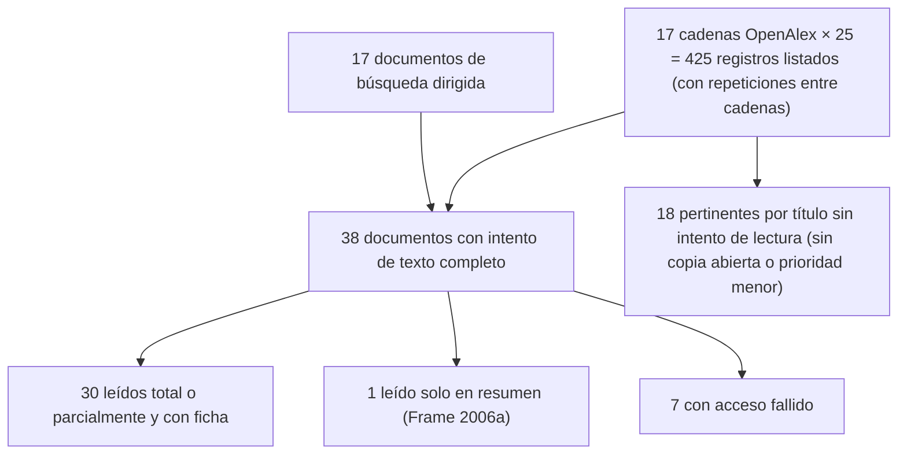

# Protocolo y registro de búsqueda

Fecha de ejecución: 11 de noviembre de 2026 (America/Lima). Un solo revisor, con asistencia computacional. Continúa el mapeo parcial de la auditoría del 20 de octubre (`docs/auditoria_2026-10-20/03_REVISION_SISTEMATICA_PRISMA.md`), sin sustituirlo.

## Tipo de revisión

Revisión de alcance (scoping review), no revisión sistemática. Las preguntas mezclan recuperación de información, estructura textil, evaluación, anotación e interpretabilidad, con métricas que no se pueden combinar. Se informa según PRISMA-ScR y PRISMA-S en lo que aplica. No hubo doble cribado, ni registro prospectivo externo, ni metaanálisis.

## Preguntas

Se mantienen las siete preguntas del protocolo previo de la auditoría (RQ1 a RQ7) y se añaden tres que responden a las observaciones del asesor del 8 de noviembre:

- RQ8. ¿Qué se sabe sobre la capacidad de los modelos visión-lenguaje para representar orden y relaciones? (sustento externo de H2)
- RQ9. ¿Qué prácticas de evaluación son defendibles con pocos temas, pooling y un solo evaluador? (puntos 6 a 8 del informe)
- RQ10. ¿Cómo se define y se verifica la fidelidad de una explicación? (H3)

## Fuentes: lo que se usó y lo que no

| Fuente | Estado | Detalle |
|---|---|---|
| OpenAlex (API pública) | Ejecutada | 17 cadenas, parámetro `search`, 25 primeros resultados por relevancia. Cuatro consultas adicionales por DOI para localizar copias abiertas |
| Crossref (API pública) | Solo comprobación de acceso | Una consulta de prueba; no se usó para ampliar. Las cuatro cadenas de la auditoría siguen siendo el único registro Crossref |
| Texto completo en acceso abierto | Ejecutada | arXiv, ACL Anthology, SpringerLink (artículos abiertos), MDPI, PLOS, CEUR-WS, PMLR, Digital Commons (UNL), irrj.org, sitio de autor (Cormack) |
| arXiv (API de exportación) | No disponible | La API rechazó la consulta automática (robots). arXiv solo se usó para leer documentos ya identificados |
| Semantic Scholar (API) | No disponible | Error del servicio |
| Búsqueda web general | No disponible | Deshabilitada para la organización en la sesión de trabajo |
| Scopus, Web of Science | NO EJECUTADA | Requieren acceso institucional UNI. Cadenas propuestas al final |
| IEEE Xplore, ACM Digital Library (búsqueda nativa) | NO EJECUTADA | Solo se llegó a registros suyos a través de OpenAlex. El texto completo de ACM falló en los dos intentos |
| ScienceDirect, Nature, Figshare, OSF | Texto completo fallido | Cinco documentos pertinentes no se pudieron leer (ver `05_pendientes_texto_completo.md`) |
| Google Scholar | NO EJECUTADA | |

No se adquirieron artículos ni se usaron cuentas institucionales. Ningún documento de pago se obtuvo por vías alternativas.

## Estrategia

1. **Búsqueda por cadenas en OpenAlex.** Las 17 cadenas literales y sus URL están en `busquedas/consultas_openalex.json`; los resultados, en `02_resultados_busqueda.md`. Un primer juego de 12 cadenas más largas, con filtro `title_and_abstract.search`, no se pudo ejecutar porque la URL superaba la longitud admitida; se sustituyó por cadenas más cortas con `search`, que busca también en el texto completo indexado. Por eso los totales son altos y poco precisos: solo se revisaron los 25 primeros de cada cadena.
2. **Búsqueda dirigida.** Diecisiete documentos se buscaron por título porque responden a RQ8–RQ10 o porque la auditoría los dejó con lectura parcial. Se declara como búsqueda de ítems conocidos: depende del conocimiento previo del revisor y no es reproducible como cadena.
3. **Localización de texto completo.** Solo copias de acceso abierto. Lo que no se pudo abrir se registró como pendiente, no como evidencia negativa.
4. **Lectura y extracción.** Cada documento se leyó con una herramienta que entrega literalmente unos 40 000 caracteres y resume el resto. En cada ficha se indica el nivel de lectura y se marca con «NV» lo que no se vio en el texto literal.

## Criterios

Inclusión: trabajos en inglés o español, hasta el 11 de noviembre de 2026, que aporten método, datos, evaluación o argumento trasladable a alguna de las diez preguntas. Exclusión por título: museología o historia del arte sin método computacional; usos metafóricos de «weaving» o «khipu»; restauración o generación de imágenes; sistemas de preguntas y respuestas sobre grafos de conocimiento; aplicaciones industriales; documentos sin arbitraje y sin método (ensayos en repositorios).

## Flujo con conteos reales

De los 38 intentos, 21 proceden de OpenAlex y 17 de la búsqueda dirigida. De las 30 fichas, 12 son documentos nuevos hallados en OpenAlex, 10 son nuevos de la búsqueda dirigida y 8 son documentos que la auditoría ya había localizado y que ahora se leyeron o releyeron (MUZE, Rei, Ngo, CLIP, Artstein y Poesio, CARE, Koh, Arnold y Tilton). Los 425 registros no se deduplicaron formalmente: el mismo trabajo aparece en varias cadenas.

## Limitaciones de esta pasada

- Un revisor, sin doble cribado.
- Una sola base bibliográfica consultada de forma nativa (OpenAlex), con 25 resultados por cadena.
- Las listas completas de 25 resultados no quedaron guardadas como exportación JSON: se revisaron en la sesión y aquí se registran los retenidos. `descargar.py --busquedas` las vuelve a exportar desde tu equipo.
- Lectura parcial de la mayoría de los artículos largos: las secciones de resultados a menudo quedaron fuera del tramo literal.
- Sesgo de idioma y de acceso abierto. La literatura en español sobre textiles andinos (Arnold y Espejo, Desrosiers, Gisbert y otros) casi no aparece.
- Antecedentes cruciales sin leer: Brownlow et al. (2015) no tiene copia abierta localizable.

## Cadenas para la búsqueda nativa pendiente (no ejecutadas)

No se atribuye ningún resultado a estas cadenas.

- Scopus: `TITLE-ABS-KEY((textile* OR weaving OR fabric*) AND (retrieval OR similarity) AND (structur* OR pattern* OR symmetr*) AND (heritage OR museum* OR archaeolog* OR andean))`
- Scopus: `TITLE-ABS-KEY((andean OR inca OR "pre-columbian" OR peru*) AND (textile* OR khipu OR quipu) AND (comput* OR "machine learning" OR ontolog* OR database))`
- Web of Science: `TS=(("cultural heritage" OR museum*) AND (CLIP OR "vision-language" OR multimodal) AND (retrieval OR search) AND (evaluat* OR benchmark))`
- IEEE Xplore y ACM DL: las familias A, B y C de `busquedas/consultas_openalex.json`, por separado, en título y resumen.
- Bases en español (SciELO, Redalyc, La Referencia): `(textil* OR tejido*) AND (andin* OR prehispánic*) AND (simetría OR estructura OR iconografía) AND (análisis OR clasificación)`
